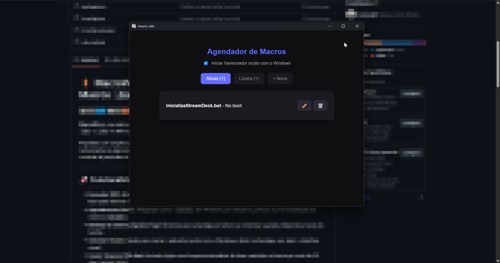
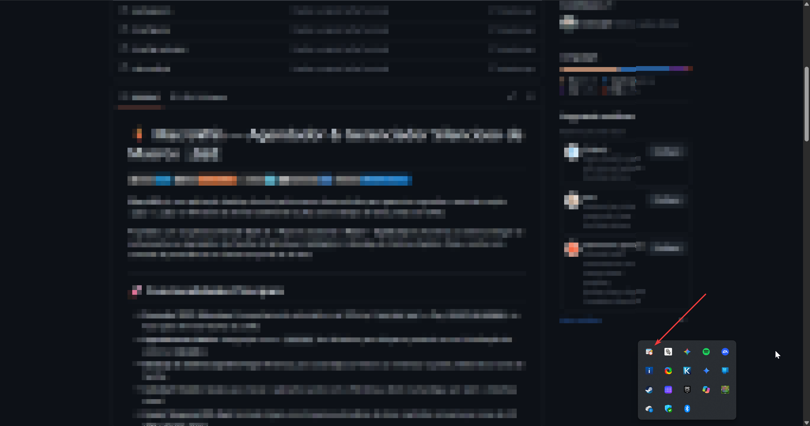

# ⚡ MacroWin — Agendador & Gerenciador Silencioso de Macros `.bat`

[](https://tauri.app/)
[](https://www.rust-lang.org/)
[](https://react.dev/)
[](https://www.typescriptlang.org/)
[](https://microsoft.com)

**MacroWin** é uma aplicação desktop de alta performance desenvolvida para gerenciar, agendar e executar scripts `.bat` e `.cmd` no Windows de forma totalmente oculta (sem exibição de telas pretas do CMD). Projetado com arquitetura híbrida **Tauri v2 + Rust** no backend e **React + TypeScript** no frontend, o sistema integra-se nativamente ao Agendador de Tarefas do Windows (`schtasks`), à Bandeja do Sistema (*System Tray*) e conta com controle de persistência em lixeira temporal de 30 dias.

## Imagens do software ```macro-win``` aberto no Windows 11:

<br>

<br>
<br>

<br>

## 🚀 Funcionalidades Principais

* **Execução 100% Silenciosa:** Encapsulamento automático via VBScript (`wscript.exe`) e flag `CREATE_NO_WINDOW` no Rust para eliminar flashes do CMD.
* **Agendamento Nativo:** Integração com o `schtasks` do Windows para disparos pontuais ou na inicialização do sistema (`ONLOGON`).
* **Bandeja do Sistema (System Tray):** Minimiza para a bandeja ao fechar ou minimizar a janela, liberando a barra de tarefas.
* **Autostart Oculto:** Opção para iniciar o aplicativo junto com o Windows, direto na bandeja, sem abrir a interface visual.
* **Lixeira Temporal (30 dias):** Exclusão lógica com limpeza automática de itens mantidos na lixeira por mais de 30 dias (`macros.json`).
* **Privilégios Elevados (UAC):** Manifesto de compilação configurado para solicitar permissão de Administrador automaticamente (`requireAdministrator`).
* **Instalador Standalone Offline:** Empacotamento via NSIS com motor WebView2 embutido para instalação sem necessidade de internet.

---

## 🛠️ Preparando o Ambiente (Máquina Limpa / Recém-Formatada)

Se você acabou de formatar o Windows e não possui nenhuma ferramenta de desenvolvimento instalada, siga esta sequência exata de instalação prévia:

### 1. Visual Studio Build Tools (C++ Compiler)
O compilador de Rust no Windows necessita dos utilitários de compilação C++ da Microsoft.
1. Baixe o [Visual Studio Installer](https://visualstudio.microsoft.com/visual-cpp-build-tools/).
2. Na aba **Cargas de trabalho (Workloads)**, selecione **Desenvolvimento para desktop com C++** (*Desktop development with C++*).
3. Conclua a instalação e reinicie a máquina se solicitado.

### 2. Rust (Linguagem do Backend)
1. Baixe o instalador oficial [rustup-init.exe](https://rustup.rs/).
2. Abra o terminal de comando e siga a instalação padrão (opção `1`).
3. Verifique a instalação abrindo um novo PowerShell:
   ```powershell
   rustc --version
   cargo --version
   ```

### 3. Node.js (Runtime do Frontend)
1. Baixe e instale a versão **LTS** do [Node.js](https://nodejs.org/).
2. O gerenciador de pacotes `npm` será instalado automaticamente. Verifique:
   ```powershell
   node --version
   npm --version
   ```

---

## 📦 Instalação e Execução do Projeto

Com o ambiente configurado, siga os passos para clonar/extrair e rodar a aplicação:

### 1. Instalar as Dependências do Projeto
Navegue até a pasta raiz do projeto e instale os pacotes Node e as extensões do Rust:

```powershell
# Instala os pacotes do React/TypeScript e da CLI do Tauri
npm install

# Garante a adição dos plugins nativos do Tauri v2 (caso clonado limpo)
npm run tauri add dialog
npm run tauri add autostart

# Navegue até a pasta do Rust para restaurar os crates do Cargo
cd src-tauri
cargo check
cd ..
```

### 2. Executar em Modo de Desenvolvimento
Para rodar a aplicação com *Hot-Reload* (React e Rust):

```powershell
npm run tauri dev
```

---

## 🏗️ Gerando o Executável de Produção (.exe)

Para compilar o software otimizado, assinado com manifesto de Administrador e empacotado em um instalador offline do Windows:

```powershell
npm run tauri build
```

### Onde encontrar os arquivos gerados?

* **Instalador Oficial (Setup .exe):**
  `src-tauri/target/release/bundle/nsis/macro-win_0.1.0_x64-setup.exe`
* **Executável Portátil (Standalone .exe):**
  `src-tauri/target/release/macro-win.exe`

---

## 📂 Estrutura do Projeto

```text
macro-win/
├── src/                        # Frontend (React + TypeScript)
│   ├── App.tsx                 # Interface gráfica, gerenciador de estado e abas
│   ├── App.css                 # Estilização em Dark Theme
│   └── main.tsx                # Ponto de entrada React
│
├── src-tauri/                  # Backend (Rust + Tauri v2)
│   ├── icons/                  # Ícones (.ico, .png) do App, janela e bandeja
│   ├── src/
│   │   ├── lib.rs              # Lógica core: SystemTray, JSON DB, schtasks e VBScript
│   │   └── main.rs             # Ponto de entrada da aplicação Rust
│   ├── build.rs                # Injeção do Manifesto UAC (requireAdministrator)
│   ├── Cargo.toml              # Dependências Rust (serde, tauri com feature tray-icon)
│   └── tauri.conf.json         # Configuração do Tauri, janelas e offlineInstaller
│
├── package.json                # Scripts npm e dependências de UI
└── README.md                   # Documentação do projeto
```

---

## 🔍 Solução de Problemas Comuns

### Error `os error 32` ao compilar (`npm run tauri dev`)
Ocorre quando o processo `.exe` anterior ficou retido na memória ou o antivírus bloqueou a pasta temporária de compilação.
```powershell
# Encerre o processo travado no PowerShell:
Stop-Process -Name "macro-win" -Force -ErrorAction SilentlyContinue

# Limpe o cache de compilação do Rust:
cd src-tauri
cargo clean
cd ..
npm run tauri dev
```

### A janela preta do CMD insiste em piscar?
Certifique-se de que a macro foi gerada pela versão refatorada da função `salvar_macro`. O backend cria automaticamente o utilitário `oculto.vbs` dentro de `app_data_dir` para que a chamada do Agendador utilize o `wscript.exe //B` em modo invisível.

---

## 📄 Licença

Este projeto é de uso privado e de automação interna. Distribuído sob a licença MIT.


# Tauri + React + Typescript

This template should help get you started developing with Tauri, React and Typescript in Vite.

## Recommended IDE Setup

- [VS Code](https://code.visualstudio.com/) + [Tauri](https://marketplace.visualstudio.com/items?itemName=tauri-apps.tauri-vscode) + [rust-analyzer](https://marketplace.visualstudio.com/items?itemName=rust-lang.rust-analyzer)
